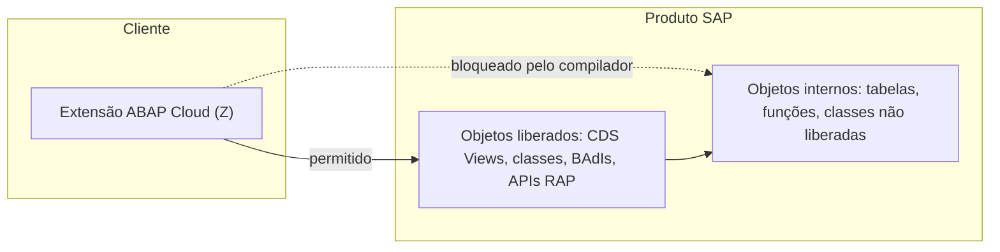
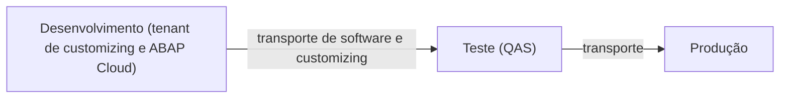
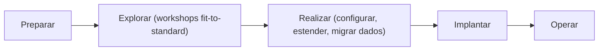

# SAP S/4HANA Cloud Public Edition - Study

> Nível: prática
> O S/4HANA em formato SaaS multi-tenant, atualizado pela SAP em ciclos fixos, estendido só com ABAP Cloud e vendido dentro do GROW with SAP. Relacionados: [SAP S/4HANA (índice da fase 0)](https://github.com/igor-barral/SAP-S4HANA-erp-study), [Cloud Private Edition](https://github.com/igor-barral/SAP-S4HANA-Cloud-Private-Edition-erp-study), [On-Premise](https://github.com/igor-barral/SAP-S4HANA-On-Premise-erp-study), [GROW with SAP](https://github.com/igor-barral/GROW-with-SAP-erp-study), [ABAP Cloud Extensibility](https://github.com/igor-barral/ABAP-Cloud-Extensibility-softwarearchitecture-study), [Clean Core](https://github.com/igor-barral/SAP-Clean-Core-softwarearchitecture-study).

## Objetivo

Entender a SAP S/4HANA Cloud Public Edition: como um ERP SaaS multi-tenant limita o que se pode fazer, por que isso é deliberado e como se estende o sistema sem ABAP clássico. É a edição onde o modelo ABAP Cloud e Clean Core deixa de ser recomendação e passa a ser regra técnica. Quem aprende a desenvolver aqui aprende o "jeito certo" que a SAP quer em todas as edições, e é por isso que as fases 2 a 6 do roadmap usam ABAP Cloud.

Ao concluir este estudo você deverá ser capaz de responder perguntas como:

- O que é a Public Edition e como ela difere da Private Edition?
- Por que o ABAP clássico não existe aqui?
- O que são *key user extensibility* e *developer extensibility*?
- Como funciona a paisagem de três sistemas?
- Como são os ciclos de atualização e o que eles exigem do desenvolvedor?
- Que tipo de cliente escolhe a Public Edition?

---

## Ponte

| No que eu já conheço | Na Public Edition |
|---|---|
| SaaS multi-tenant (um código, vários clientes, banco isolado por tenant) | Mesmo modelo: a SAP opera uma base de código para todos os clientes |
| Plataforma SaaS que oferece campos customizados e webhooks, mas não deixa editar o código do produto | *Key user extensibility*: campos, lógica e objetos custom por apps Fiori, sem acesso ao núcleo |
| SDK público com contrato de estabilidade e *deprecation policy* | APIs liberadas (*released APIs*) com contrato de estabilidade |
| Plugin que só pode usar a API pública do produto, nunca as tabelas internas | *Developer extensibility*: ABAP Cloud usando só objetos liberados |
| Deploy contínuo do fornecedor: o produto atualiza sozinho e você testa a sua integração | Upgrades automáticos em ciclos fixos definidos pela SAP |
| Aplicação separada que consome a API do SaaS | Extensão *side-by-side* no SAP BTP |
| Implantação de ERP pronto em que o cliente adapta o processo ao sistema | *Fit-to-standard* |

---

## Conteúdo

### 1. O que é

A Public Edition é o ERP SaaS da SAP. Um mesmo produto, operado e atualizado pela SAP para todos os clientes, com isolamento de dados por tenant. O cliente **não tem acesso** a SPRO completo, SAP GUI para desenvolvimento, SE80, modificações do padrão ou leitura direta de tabelas SAP. Em troca, recebe atualizações frequentes sem projeto de upgrade.

| Aspecto | Public Edition |
|---|---|
| Tenancy | Multi-tenant (código compartilhado, dados isolados) |
| Operação | SAP |
| Upgrades | Automáticos, em calendário definido pela SAP |
| Configuração | Guiada, por *SAP Central Business Configuration* e apps de configuração, a partir de processos de referência (*SAP Best Practices*) |
| Interface | Fiori |
| Desenvolvimento | ABAP Cloud apenas, e extensões no BTP |
| Modificação do padrão | Não existe |
| Migração de ECC | Nova implantação com migração de dados (não há conversão de sistema) |

### 2. Por que o ABAP clássico não existe aqui

Num SaaS que se atualiza sozinho, **qualquer código que dependa de detalhes internos quebra no próximo upgrade**. Se um cliente pudesse fazer `SELECT` direto numa tabela interna, ou modificar um programa SAP, a SAP teria de escolher entre travar a evolução do produto ou quebrar o cliente.

A resposta é o modelo ABAP Cloud:

- A versão de linguagem **ABAP for Cloud Development** faz o **compilador** recusar acesso a objetos não liberados. Não é só uma verificação de ATC: o código não ativa.
- Não há dynpro, listas clássicas, `CALL TRANSACTION`, acesso a arquivos do servidor nem SQL nativo.
- Objetos liberados têm **contrato de estabilidade**: a SAP se compromete a não quebrá-los em upgrades, ou a descontinuá-los com antecedência e sucessor indicado.

É o mesmo ABAP Cloud da BTP ABAP Environment usada nas fases 1 a 6 do roadmap.

### 3. Formas de extensão

| Forma | Quem faz | Ferramenta | Exemplos |
|---|---|---|---|
| *Key user extensibility* (in-app) | Usuário-chave ou consultor funcional | Apps Fiori de extensibilidade | Campos custom, lógica custom em pontos de extensão, objetos de negócio custom, CDS Views custom, ajustes de UI |
| *Developer extensibility* (on-stack) | Desenvolvedor ABAP | ADT (Eclipse) no tenant de desenvolvimento | Classes ABAP Cloud, CDS, RAP, implementações de BAdIs liberadas, apps Fiori |
| *Side-by-side* | Desenvolvedor BTP | SAP BTP (CAP, ABAP Environment, Integration Suite, Build) | Apps separados que consomem APIs OData/SOAP e eventos do S/4HANA |

A escolha segue uma ordem prática: primeiro configurar; se não bastar, *key user*; se não bastar, *developer extensibility*; se a extensão for grande, independente ou precisar de outra tecnologia, *side-by-side*. O detalhamento está em [ABAP-Cloud-Extensibility-softwarearchitecture-study](https://github.com/igor-barral/ABAP-Cloud-Extensibility-softwarearchitecture-study).

### 4. Paisagem de três sistemas

*Developer extensibility* exige uma paisagem com três sistemas (*3-system landscape*): desenvolvimento, teste e produção. Os nomes, a forma de provisionamento e se o cliente recebe tenants adicionais (por exemplo, um tenant de *starter* para exploração) dependem do contrato e do momento do projeto; confirme na documentação.

- No sistema de desenvolvimento, o desenvolvedor usa o ADT e cria objetos em pacotes de software, como na BTP ABAP Environment.
- Transportes são gerenciados por apps Fiori (colecionar e exportar itens de software e customizing), não pela STMS clássica.
- Cada ciclo de upgrade chega aos sistemas em momentos definidos, e os testes regressivos das extensões precisam acompanhar esse calendário.

### 5. Ciclos de atualização

A SAP atualiza a Public Edition em **ciclos fixos**, com releases identificadas por ano e mês (padrão `AAMM`, como 2402, 2408) e pacotes de correção entre elas. O ritmo já mudou ao longo do tempo (houve fase trimestral e hoje há menos releases principais por ano); confirme o calendário vigente no SAP Help Portal.

O que isso exige do desenvolvedor:

- **Testes automatizados** das extensões (ABAP Unit, testes de apps), porque o upgrade não espera o cliente.
- **Acompanhar o *What's New*** e a lista de objetos descontinuados de cada release.
- **Nunca depender de comportamento não documentado**, mesmo de objetos liberados.

### 6. Implantação: fit-to-standard

A Public Edition é implantada com a metodologia **SAP Activate**, cuja lógica central é o *fit-to-standard*: o cliente é apresentado aos processos de referência já configurados e adapta o seu processo a eles, em vez de o sistema ser adaptado ao processo. As lacunas são tratadas com configuração, extensões ou mudança de processo.

Dados do sistema anterior (ECC, outro ERP ou planilhas) entram pelo **SAP S/4HANA Migration Cockpit**, com modelos de migração padrão. Ver [SAP-S4HANA-Migration-Cockpit-erp-study](https://github.com/igor-barral/SAP-S4HANA-Migration-Cockpit-erp-study).

### 7. Que tipo de cliente escolhe a Public Edition

| Perfil | Por quê |
|---|---|
| Empresa de médio porte em crescimento | Quer ERP completo sem equipe de Basis nem projeto de upgrade |
| Subsidiária de grupo que usa SAP (*two-tier ERP*) | Matriz em Private Edition ou on-premise, filiais em Public Edition, integradas |
| Empresa nova ou que troca de ERP | Implantação nova, sem legado a preservar |
| Empresa que aceita o processo padrão | O modelo só funciona se o cliente adaptar o processo ao sistema |
| Setores cobertos pelos processos de referência | A cobertura funcional é diferente da do on-premise; verifique país e indústria |

Quem **não** costuma escolher: empresas com ECC muito customizado, processos industriais muito específicos, localização fiscal ainda não coberta ou dependência forte de integrações clássicas.

### 8. Comparação rápida com a Private Edition

| | Private Edition | Public Edition |
|---|---|---|
| Código-base | Igual ao on-premise | Produto SaaS |
| Tenancy | Dedicado | Multi-tenant |
| Customizing | SPRO completo | Configuração guiada |
| ABAP | Clássico e Cloud | Só Cloud |
| SAP GUI | Sim | Não para desenvolvimento e customizing |
| Upgrade | Planejado com o cliente | Automático, calendário da SAP |
| Conversão de ECC | Sim | Não |
| Pacote | RISE | GROW |

### 9. O que perguntar no início de um projeto Public Edition

| Pergunta | Por que importa |
|---|---|
| A demanda cabe em configuração ou em *key user extensibility*? | Muitas vezes não é preciso código ABAP |
| Existe o objeto liberado (CDS, BAdI, API) de que a extensão precisa? | Se não existir, a solução muda de desenho, ou vai para *side-by-side* |
| Qual a release atual e a data do próximo upgrade? | Define a janela de testes regressivos |
| Os três sistemas já estão provisionados e com acesso pelo ADT? | Sem o sistema de desenvolvimento não há *developer extensibility* |
| Quais integrações usam APIs publicadas e quais precisam de Integration Suite? | Integrações são o maior volume de trabalho técnico nessa edição |
| Qual o processo de transporte entre os sistemas? | Feito por apps Fiori, diferente da STMS |

---

## Respostas

**O que é a Public Edition e como difere da Private Edition?**
É o S/4HANA em SaaS multi-tenant, operado e atualizado pela SAP para todos os clientes. A Private Edition é o código do on-premise num ambiente dedicado; a Public Edition é um produto SaaS com configuração guiada, sem SPRO completo, sem ABAP clássico e sem modificação do padrão.

**Por que o ABAP clássico não existe aqui?**
Porque um SaaS atualizado automaticamente não pode ter código de cliente dependente de objetos internos. O ABAP Cloud faz o compilador aceitar só objetos liberados, que têm contrato de estabilidade, e isso permite à SAP atualizar sem quebrar extensões.

**O que são key user e developer extensibility?**
*Key user* são extensões feitas por apps Fiori, sem código ABAP tradicional: campos, lógica em pontos de extensão, objetos e views custom. *Developer* é ABAP Cloud no ADT, no tenant de desenvolvimento, com CDS, RAP, classes e BAdIs liberadas.

**Como funciona a paisagem de três sistemas?**
Desenvolvimento, teste e produção. Extensões e customizing são criados no desenvolvimento e transportados por apps Fiori para teste e produção. É o que permite *developer extensibility* com separação de ambientes.

**Como são os ciclos de atualização?**
Releases em calendário fixo definido pela SAP, identificadas por ano e mês, com correções entre elas. O cliente não escolhe se atualiza, então precisa de testes automatizados e de acompanhar as mudanças e descontinuações de cada release.

**Que tipo de cliente escolhe a Public Edition?**
Empresas de médio porte, subsidiárias em modelo *two-tier*, empresas novas ou que trocam de ERP e, sobretudo, empresas dispostas a adotar o processo padrão. É quase sempre uma implantação nova.

---

## Referências

- SAP Help Portal: https://help.sap.com (buscar "SAP S/4HANA Cloud Public Edition", "extensibility", "3-system landscape")
- SAP Learning: https://learning.sap.com (buscar "SAP S/4HANA Cloud Public Edition", "SAP Activate")
- SAP Business Accelerator Hub: https://api.sap.com (APIs publicadas da Public Edition)
- SAP Community: https://community.sap.com (buscar "developer extensibility public edition", "ABAP Cloud")
